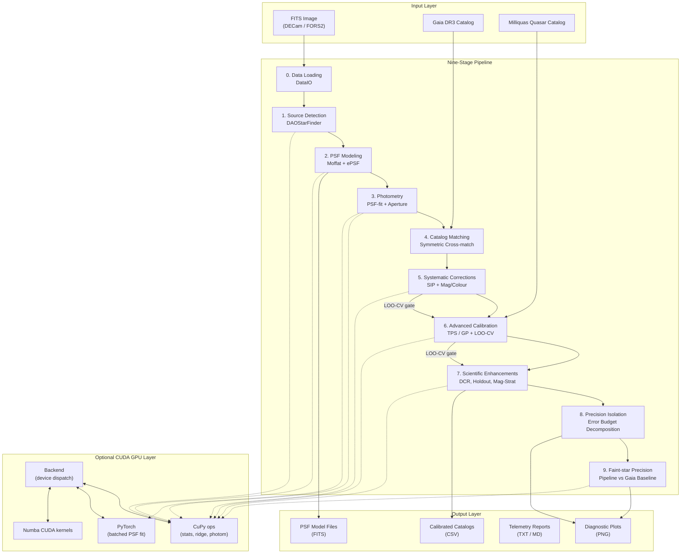
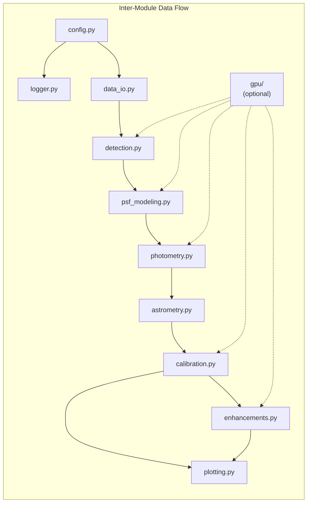
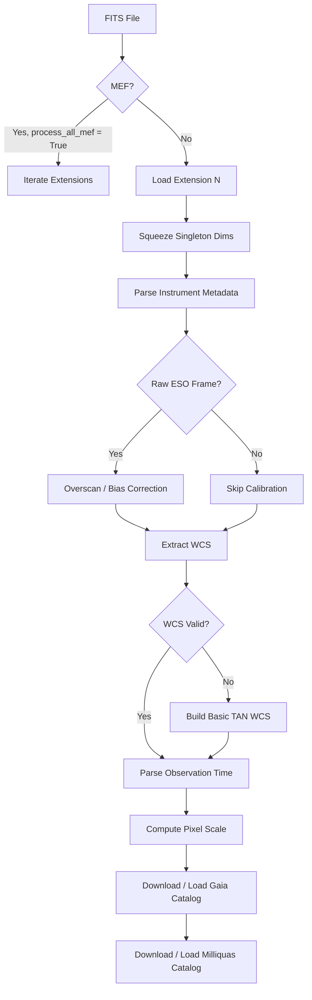
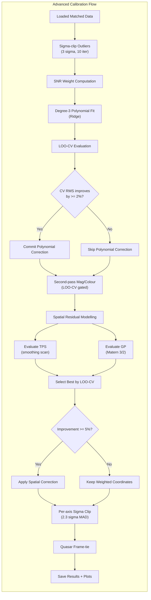

# PSF-match: A Unified Photometric and Astrometric Calibration Pipeline

## Abstract

PSF-match is an end-to-end pipeline for differential astrometric calibration of ground-based astronomical images. It detects stellar sources, models the point spread function (PSF) both parametrically and empirically, extracts photometry, and matches sources to the Gaia DR3 reference frame after propagating proper motions to the observation epoch. The core of the pipeline is a multi-stage systematic correction engine that iteratively removes geometric distortion (SIP polynomial), magnitude- and colour-dependent offsets, and spatially correlated residuals using thin-plate spline or Gaussian Process regression, with every correction gated by leave-one-out cross-validation. On DECam test data the pipeline delivers approximately 8.5 mas in-sample RMS and approximately 9.9 mas unbiased holdout RMS, approaching the photon-noise and atmospheric fundamental limits.

## Pipeline Architecture





On DECam data (r-band, 90 s exposure), the pipeline achieves 8.5 mas in-sample RMS and 9.9 mas holdout RMS from approximately 100 matched stars, with an instrumental precision floor of approximately 2.8 mas after removing modelled atmospheric (Kolmogorov) and Gaia reference-frame contributions.

## Table of Contents

1.  [Features](#1-features)
2.  [Installation](#2-installation)
3.  [Dependencies](#3-dependencies)
4.  [Usage](#4-usage)
5.  [Input Data Specification](#5-input-data-specification)
6.  [Pipeline Stages](#6-pipeline-stages)
7.  [Mathematical Framework](#7-mathematical-framework)
8.  [Output Structure](#8-output-structure)
9.  [Supported Instruments](#9-supported-instruments)
10. [Validation and Performance](#10-validation-and-performance)
11. [Optional CUDA GPU Support](#11-optional-cuda-gpu-support)
12. [Testing](#12-testing)
13. [License](#13-license)
14. [References](#14-references)

## 1. Features

**Source Detection and Characterisation**

- Iterative DAOStarFinder with up to three passes converging on characteristic FWHM.
- 2D elliptical Gaussian fit via scipy for FWHM re-estimation from the twenty brightest stars.
- MAD-based outlier rejection on FWHM estimates.
- Background estimation via sigma-clipped statistics (3 sigma).

**PSF Construction**

- Parametric Moffat PSF with beta fixed at 3 and alpha derived from the converged FWHM.
- Empirical ePSF via photutils EPSFBuilder with configurable oversampling (default 4) and iterations (default 10), star selection with border, saturation, and minimum-separation criteria.
- Azimuthal homogenisation via radial binning (0.5 px bins), MAD-clipped median profile, PCHIP interpolation, and flux normalisation.
- Both original and homogenised ePSF saved as FITS files.

**Photometry**

- PSF-fitting photometry via LevMarLSQFitter for Moffat and empirical models, with local background estimation.
- Aperture photometry via CircularAperture at 1.5 times FWHM with CircularAnnulus background subtraction.
- Per-method coordinate files (RA/Dec) saved for downstream matching.

**Astrometric Matching**

- Proper motion propagation of Gaia coordinates to the observation epoch using SkyCoord.apply\_space\_motion.
- Symmetric bidirectional cross-matching (match\_to\_catalog\_sky) with configurable maximum separation (default 2 arcsec).
- Quality cuts: Gaia G magnitude in [6, 21.5], RUWE at most 1.4 (astrometric binary exclusion), BP-RP colour in [0, 2.5].
- Per-method match statistics (N, RMS RA/Dec, median separation) saved to log files.

**Systematic Astrometric Corrections**

- Iterative SIP-style geometric distortion modelling via Ridge regression (order 2 to 4, adaptively reduced for small samples).
- Magnitude and colour systematic correction with optional DCR interaction term: (airmass minus 1) times colour.
- SNR-based inverse-variance weighting calibrated to DES r-band 5-sigma depth (23.7 mag).
- Iterative sigma-clipped outlier rejection between correction passes.

**Advanced Calibration**

- Robust polynomial regression with leave-one-out cross-validation gating (correction committed only if LOO-CV RMS improves by at least 2 percent).
- Second-pass colour and magnitude correction on post-polynomial residuals, LOO-CV gated.
- Spatial residual modelling via thin-plate spline (RBFInterpolator, kernel thin\_plate\_spline) or Gaussian Process (GaussianProcessRegressor, Matern 3/2 plus WhiteKernel), auto-selected by LOO-CV with a 5 percent improvement threshold.
- Per-axis MAD-based sigma clipping with configurable threshold (default 2.3 sigma) for final outlier rejection.
- Quasar frame-tie to ICRF via Milliquas catalog (symmetric matching, median offset).

**Scientific Enhancements**

- DCR correction using a linear model in parallactic-angle-projected residuals, with coefficients a and b (offset and BP-RP slope) fitted via weighted least squares, gated by LOO-CV (at least 1 percent improvement required).
- Strict holdout cross-validation with 5 random 70/30 splits, degree-2 polynomial regression, reporting unbiased predictive RMS and overfit ratio.
- Magnitude stratification with 1-mag bins, identifying the photon-noise break magnitude where RMS exceeds sqrt(2) times the minimum bin RMS.
- Faint-star local anchoring using affine transforms from the 25 nearest bright stars within 200 px, with SNR-based weighting.
- CCD edge diagnostics (radial profiles, edge versus centre RMS) and empirical tree-ring correction using sinusoidal terms at periods 200, 300, and 500 px, LOO-CV gated.

**Instrumental Precision Isolation**

- Quadrature error budget decomposition:

$$\sigma_{\text{total}}^2 = \sigma_{\text{inst}}^2 + \sigma_{\text{atm}}^2 + \sigma_{\text{Gaia}}^2$$

- Kolmogorov turbulence atmospheric model: sigma\_atm proportional to t^{-1/2} times (airmass)^{0.6}, normalised to 15 mas at 30 s and airmass 1.3 (Bernstein et al. 2017), with lower 12 mas base for Paranal.

**Optional CUDA GPU Support**

- Optional GPU acceleration via CuPy, Numba CUDA, and PyTorch.  All GPU libraries are optional; the pipeline runs in a fully functional CPU-only mode without them.
- Central device dispatcher with automatic CPU fallback when CUDA is unavailable, when the input is too small to benefit from offload, or when a GPU primitive raises an exception.
- GPU-accelerated sigma-clipped statistics, MAD-clipped radial profile, batched aperture photometry, weighted Ridge solve, closed-form leave-one-out CV for linear models, pairwise neighbour search, and binned statistics.
- Batched nonlinear PSF fitting via PyTorch L-BFGS with deterministic mode for reproducible bootstrap/holdout runs.
- Per-stage GPU toggles, configurable batch sizes, memory-aware batching, and multi-extension FITS (MEF) planning for future multi-GPU execution.
- Backward-compatible configuration and CLI; all existing flags, defaults, and output behaviour preserved.

## 2. Installation

Clone the repository and install the dependencies:

```bash
git clone https://github.com/wolf9611/psf-match-astrometry.git
cd psf-match-astrometry
pip install -r requirements.txt
```

The pipeline runs directly from the repository root; there is no build system or setup.py. Python 3.11 or later is recommended.

### Optional CUDA GPU support

GPU acceleration is **entirely optional**.  The pipeline runs in a fully functional CPU-only mode without any GPU libraries installed.  To enable optional CUDA acceleration, install the additional GPU dependencies:

```bash
pip install -r requirements-gpu.txt
```

The GPU layer uses [CuPy](https://cupy.dev/) for SciPy-like GPU operations, [Numba CUDA](https://numba.readthedocs.io/en/stable/cuda/index.html) for custom kernels, and [PyTorch](https://pytorch.org/) for batched nonlinear PSF fitting.  All three libraries are optional; the dispatcher falls back to the CPU implementation for any operation whose GPU library is unavailable, whose input is too small to benefit from offload, or whose GPU execution raises an exception.

CuPy ships as CUDA-version-specific wheels.  The default `requirements-gpu.txt` installs the CUDA 12.x wheel (`cupy-cuda12x`); for CUDA 13.x environments replace it with `cupy-cuda13x`.  See the [CuPy installation guide](https://docs.cupy.dev/en/stable/install.html) for details.

## 3. Dependencies

### Core (CPU-only) dependencies

| Package       | Version (recommended) | Purpose                             |
|---------------|-----------------------|-------------------------------------|
| numpy         | 2.5 or later          | Numerical computing                 |
| pandas        | 3.0 or later          | DataFrame catalog manipulation      |
| matplotlib    | 3.11 or later         | Diagnostic plots (Agg backend)      |
| astropy       | 8.0 or later          | FITS I/O, WCS, SkyCoord, Time       |
| photutils     | 3.0 or later          | DAOStarFinder, EPSFBuilder, PSFPhot |
| scikit-learn  | 1.9 or later          | Ridge, GP, PolynomialFeatures       |
| scipy         | 1.18 or later         | RBFInterpolator, curve\_fit, PCHIP  |
| astroquery    | 0.4 or later          | Gaia archive and Vizier queries     |
| pytest        | 9.1 or later          | Unit testing (optional)             |
| pytest-cov    | 7.1 or later          | Coverage reporting (optional)       |

### Optional CUDA GPU dependencies

The following libraries enable GPU acceleration.  None of them is required for the pipeline to run; the dispatcher transparently falls back to the CPU implementation when any of them is missing.

| Package       | Version (recommended) | Purpose                                                |
|---------------|-----------------------|--------------------------------------------------------|
| cupy-cuda12x  | 14.1 or later         | SciPy-like GPU arrays and linear algebra               |
| numba         | 0.66 or later         | Custom CUDA kernels (sigma-clip, pairwise, radial bin) |
| torch         | 2.13 or later         | Batched nonlinear PSF fitting via L-BFGS               |

For CUDA 13.x environments, install `cupy-cuda13x` in place of `cupy-cuda12x`.  See `requirements-gpu.txt` for the canonical pin set.

## 4. Usage

The pipeline is invoked from the repository root:

```bash
python main.py [options]
```

### Command-line arguments

```
--preset, -p          Instrument preset (FORS2)
--instrument, -i      Instrument name for output directory naming
--image               Path to input FITS image
--gaia-catalog        Path to Gaia reference catalog CSV
--no-milliquas        Disable Milliquas quasar frame-tie
--no-clean            Skip cleanup of old output files
--extension           FITS extension number to process (default 0, auto-detect)
--pm-mode             Proper motion handling: full, damped (default),
                      or none (epoch positions only)
--no-faint-stars      Exclude faint stars (G>=20) — strict RUWE<=1.4,
                      drop 2-parameter solutions
--compare-faint-stars Run twice (with/without faint stars) and write
                      comparison report

# Optional CUDA GPU control
--device              auto (default), cpu, or cuda
--no-gpu-fallback     Disable silent GPU-to-CPU fallback
--deterministic       Enable deterministic GPU execution
--image-precision     float32 or float64 (default)
--astrometry-precision  float32 or float64 (default)
--gpu-batch-size      Batch size for GPU-batched operations (default 4096)
--gpu-stage STAGE=BOOL  Per-stage GPU toggle (repeatable)
--gpu-disable-all     Force-disable GPU acceleration on every stage
--gpu-timing          Log per-stage device selection and timings
--gpu-workers         Worker readiness for future multi-GPU MEF (default 1)
```

A Jupyter notebook demonstrating the full pipeline with all CLI flags
is available at `notebooks/psf_match_pipeline.ipynb`.

### Examples

FITS images and Gaia catalogs are not included in this repository. Place your own files under `input/` as described in [Input Data Specification](#5-input-data-specification). `python main.py` with no extra arguments reads `input/DECam/image.fits` and, when `input/DECam/gaia_catalog.csv` is missing, downloads Gaia DR3 for that field (`auto_download_gaia` defaults to `True`).

Process your own DECam image:

```bash
python main.py --image input/DECam/image.fits --gaia-catalog input/DECam/gaia_catalog.csv
```

Process your own FORS2 image with the instrument preset. The preset looks for `input/FORS2/eso_fors2_single_01.fits` and `input/FORS2/gaia_catalog_fors2.csv`; pass `--image` or `--gaia-catalog` when your filenames differ:

```bash
python main.py --preset FORS2 \
    --image input/FORS2/eso_fors2_single_01.fits \
    --gaia-catalog input/FORS2/gaia_catalog_fors2.csv
```

Process a custom image with a specific Gaia catalog and disable the quasar frame-tie:

```bash
python main.py --image path/to/image.fits --gaia-catalog path/to/gaia.csv --no-milliquas
```

Process extension 1 of a multi-extension FITS file:

```bash
python main.py --image path/to/mef.fits --extension 1
```

Run a two-way comparison to assess the impact of including faint stars:

```bash
python main.py --compare-faint-stars
```

This runs the pipeline twice (to `output/<instrument>/comparison/exclude_faint_pm_{mode}/`
and `output/<instrument>/comparison/include_faint_pm_{mode}/` where ``{mode}`` is the
current ``--pm-mode`` setting) and writes a comparison
report to `output/<instrument>/comparison/logs/faint_star_comparison_report.md`.

Run with no proper motion propagation (epoch positions only):

```bash
python main.py --pm-mode none
```

Run with full proper motion (no damping):

```bash
python main.py --pm-mode full
```

Force CPU-only execution (overrides any installed GPU libraries):

```bash
python main.py --device cpu
```

Force CUDA execution with deterministic kernels for reproducible bootstrap/holdout runs:

```bash
python main.py --device cuda --deterministic --gpu-timing
```

Disable GPU acceleration for the photometry stage only, while keeping it enabled for detection, PSF modelling, and calibration:

```bash
python main.py --device cuda --gpu-stage photometry=false
```

Run batched photometry with a custom batch size (useful for tuning GPU memory usage):

```bash
python main.py --device cuda --gpu-batch-size 8192
```

## 5. Input Data Specification

Science images and reference catalogs are not distributed with this repository. The pipeline reads whatever you place at the paths below, or at the paths you pass on the command line.

### Expected input layout

```
input/
  DECam/
    image.fits                  # your DECam (or other) science image
    gaia_catalog.csv            # optional cache; written when Gaia DR3 is downloaded
  FORS2/
    eso_fors2_single_01.fits    # your FORS2 science image
    gaia_catalog_fors2.csv      # optional cache for the FORS2 field
  milliquas_catalog.csv         # optional cache; written when Milliquas is downloaded
  xy.txt                        # only for process_xy_only mode
```

`output/` is created at runtime (catalogs, diagnostic PNGs, PSF FITS models, logs). Those products are generated from your images and are listed in `.gitignore`.

### Obtaining public data

**DECam.** Download a public DECam exposure or coadd from the NOIRLab Astro Data Archive (https://astroarchive.noirlab.edu/) and save it as `input/DECam/image.fits`, or pass another path with `--image`. When you use Dark Energy Survey or other NOIRLab holdings, credit the survey and NSF's NOIRLab.

**FORS2.** Download a public FORS2 frame from the ESO Science Archive (https://archive.eso.org/) and save it as `input/FORS2/eso_fors2_single_01.fits` to match the FORS2 preset, or pass `--image`. Credit ESO and the original observing programme.

**Gaia DR3.** The CSV catalogs are not included. They are public and can be regenerated for any field. With `auto_download_gaia=True` (the default), a missing or incomplete catalog triggers an `astroquery.Gaia` cone search of `gaiadr3.gaia_source`, centred on the image, and the result is written to the configured CSV path. The same query can be run by hand, or the table can be exported from the Gaia archive (https://gea.esac.esa.int/archive/):

```python
from astropy.coordinates import SkyCoord
import astropy.units as u
from astroquery.gaia import Gaia

Gaia.MAIN_GAIA_TABLE = "gaiadr3.gaia_source"
Gaia.ROW_LIMIT = -1
coord = SkyCoord(ra=RA_DEG, dec=DEC_DEG, unit="deg", frame="icrs")
job = Gaia.cone_search_async(coord, radius=0.5 * u.deg)
job.get_results().to_pandas().to_csv(
    "input/DECam/gaia_catalog.csv", index=False
)
```

Credit the Gaia Collaboration and ESA. Required and optional columns are listed under [Gaia DR3 Catalog](#gaia-dr3-catalog).

**Milliquas.** When the quasar frame-tie is enabled, the pipeline queries VizieR catalogs VII/294 or VII/290 through astroquery and caches `input/milliquas_catalog.csv`. Credit Milliquas (Flesch).

**Your own images.** Any single-extension or multi-extension FITS image with a usable WCS (or with header keywords from which the loader can build a TAN WCS) can be passed with `--image`. Point `--gaia-catalog` at a CSV with the columns below, or leave the file absent and let the pipeline download Gaia DR3 for that field.

### FITS Image

The pipeline accepts standard FITS images from optical and near-infrared instruments. Two header conventions are supported:

- **DES / NOIRLab convention**: keywords such as INSTRUME, TELESCOP, FILTER, EXPTIME, GAIN, SATURATE, AIRMASS, SEEING.
- **ESO hierarchical convention**: keywords such as HIERARCH ESO INS ID, HIERARCH ESO TEL ID, HIERARCH ESO INS FILT1 NAME, HIERARCH ESO DET EXP1 TIME, HIERARCH ESO TEL AIRM START.

Multi-Extension FITS (MEF) is supported: the pipeline auto-discovers image-like extensions and processes the requested extension (configurable via the --extension flag). Setting process\_all\_mef\_extensions to True in the configuration iterates over all extensions.

For raw ESO frames, an automatic overscan bias correction is applied by detecting low-variance columns at the detector edge, subtracting a per-row bias level.

If the native WCS is missing or invalid, a basic TAN projection WCS is constructed from keyword-derived pixel scale and centre coordinates.

### Gaia DR3 Catalog

The catalog must contain the following columns:

- ra, dec (ICRS coordinates at epoch ref\_epoch)
- pmra, pmdec (proper motions in mas/yr)
- ref\_epoch (reference epoch in years, typically 2016.0)
- phot\_g\_mean\_mag (G-band magnitude)
- bp\_rp (BP minus RP colour, optional but recommended)
- ruwe (Re-normalised Unit Weight Error, optional but recommended)
- pmra\_error, pmdec\_error (proper motion uncertainties, optional)
- ra\_error, dec\_error (positional uncertainties, optional)

If the catalog file is missing or lacks any of the critical columns (``ruwe``,
``pmra_error``, ``ra_error``), and ``auto_download_gaia`` is ``True`` (the
default), the pipeline automatically queries the Gaia archive via
``astroquery.Gaia`` with a cone search centred on the image field of view.
The downloaded catalog includes:

- All columns listed above
- ``parallax``, ``astrometric_matched_transits``, ``astrometric_excess_noise``

The search radius is set to 1.1 times the maximum corner separation from the
field centre, subject to a configurable minimum (``gaia_search_radius_deg``,
default 0.5 degrees).

A cached catalog that originates from a different part of the sky (RA or Dec
offset exceeding 2 degrees) triggers a re-download.

The per-star astrometric error columns (``ra_error`` / ``dec_error``) are
used downstream in the inverse-variance weighting (Stage 6), replacing the
legacy magnitude-only approximation with the actual Gaia positional
uncertainty per source.  The proper motion errors (``pmra_error`` /
``pmdec_error``) enable adaptive PM damping (Stage 4) that scales back the
epoch propagation for stars with uncertain proper motions.

### Milliquas Quasar Catalog

Used for absolute frame-tie to ICRF. The pipeline queries the Milliquas catalog (VII/294 or VII/290) via astroquery Vizier, filtering for objects whose Type field contains Q. The same field-of-view and cache validation logic as the Gaia catalog applies.

Configuration flag use\_milliquas controls whether this step is executed (default False in the FORS2 preset).

### Instrument Presets

Presets are defined in src/config.py in the PRESETS dictionary. Currently one preset is defined. The paths are where the preset looks on disk; the files themselves are not included in the repository:

| Preset | Image Path | Gaia Catalog Path | use\_milliquas |
|--------|------------|-------------------|----------------|
| FORS2  | input/FORS2/eso\_fors2\_single\_01.fits | input/FORS2/gaia\_catalog\_fors2.csv | False |

Applying a preset sets the corresponding config attributes; individual CLI arguments can override specific fields.

## 6. Pipeline Stages

### Stage 0: Data Loading

The DataIO class handles all input operations. It loads the FITS image, extracts the header, parses instrument metadata, constructs or validates the WCS, computes the observation time, and optionally downloads reference catalogs.



Key header values parsed during this stage:

- Instrument name and telescope
- Filter identification
- Exposure time
- Gain (e-/ADU)
- Saturation level (instrument-specific defaults when missing)
- Airmass
- DIMM seeing
- Observation time (from MJD-OBS, DATE-OBS, or ESO-specific keywords)

### Stage 1: Source Detection

The SourceDetector class estimates the background via sigma-clipped statistics, then runs DAOStarFinder iteratively (up to three iterations) to converge on the characteristic PSF FWHM.

**Algorithm**

1. Compute background median and RMS from sigma-clipped pixel statistics (3 sigma).
2. Subtract background to produce a clean image.
3. Initialise FWHM guess: max(2.0, 1.0 / pixel\_scale) to approximate 1 arcsec seeing.
4. For each iteration:
   - Run DAOStarFinder with the current FWHM and a threshold of 5 sigma times background RMS.
   - Select the 20 brightest detected sources.
   - Fit a 2D elliptical Gaussian to each source via scipy.optimize.curve\_fit with bounded parameters.
   - Compute FWHM from the average of the two fitted sigma values: FWHM = 2.355 * sigma\_avg.
   - Apply MAD-based outlier rejection (2.5 * 1.4826 * MAD).
   - Update the FWHM estimate to the median of the surviving fits.
5. Converge when the fractional FWHM change drops below 5 percent.

The 2D Gaussian model used for each star is:

$$f(x, y) = A \exp\left(-\left[a(x-x_0)^2 + 2b(x-x_0)(y-y_0) + c(y-y_0)^2\right]\right) + z$$

where

$$a = \frac{\cos^2\theta}{2\sigma_x^2} + \frac{\sin^2\theta}{2\sigma_y^2}, \quad
b = -\frac{\sin 2\theta}{4\sigma_x^2} + \frac{\sin 2\theta}{4\sigma_y^2}, \quad
c = \frac{\sin^2\theta}{2\sigma_x^2} + \frac{\cos^2\theta}{2\sigma_y^2}.$$

Detected sources are saved as a CSV file with pixel coordinates, peak counts, and WCS-derived RA and Dec.

### Stage 2: PSF Modelling

The PSFModeler class constructs two PSF representations from the cleaned image and the detected source list.

**Moffat PSF**

The Moffat profile is a parametric model defined by:

$$M(r) = \left(1 + \frac{r^2}{\alpha^2}\right)^{-\beta}$$

with beta fixed at 3. The scale parameter alpha is derived from the estimated FWHM:

$$\alpha = \frac{\text{FWHM}}{2 \sqrt{2^{1/\beta} - 1}}$$

**Empirical ePSF**

The empirical PSF is constructed via photutils EPSFBuilder with oversampling = 4 and up to 10 iterations. Star selection criteria:

- Minimum distance of PSF\_SIZE pixels from the image border.
- Peak counts below the saturation level.
- Minimum separation of 3 times FWHM between selected stars.
- Up to epsf\_n\_stars (default 30) stars selected, sorted by peak brightness.

**Azimuthal Homogenisation**

An optional post-processing step that replaces the 2D ePSF with its azimuthally averaged radial profile:

1. Compute radial distances from the PSF centre.
2. Bin pixels into radial annuli of width 0.5 px.
3. For each annulus, compute the MAD-clipped median (3 sigma threshold).
4. Interpolate missing bins linearly.
5. Construct a radial profile via PCHIP interpolation from the centre (peak value) through the binned profile to zero at the boundary.
6. Normalise the homogenised PSF to preserve the total flux of the original ePSF.

Both the original and homogenised ePSF are saved as FITS files.

### Stage 3: Photometry

The Photometry class executes three photometric extraction methods.

**PSF-fitting Photometry**

Uses photutils PSFPhotometry with LevMarLSQFitter for the Moffat and empirical PSF models. Initial parameters are taken from the DAOStarFinder catalogue: centroid positions and flux estimated as peak times 2 pi (FWHM / 2.355)^2. The fit uses a square stamp of size 2 * ceil(2.5 * FWHM) + 1 pixels. Local background is estimated from a circular annulus with inner radius 2.5 * FWHM and outer radius 5.0 * FWHM using MMMBackground.

**Aperture Photometry**

Uses CircularAperture with radius 1.5 * FWHM. Sky background is estimated from a circular annulus with inner radius 3.0 * FWHM and outer radius 5.0 * FWHM, subtracted on a per-source basis.

Coordinates for each method are saved as xy\_radec\_{method}.txt files with RA and Dec columns derived from the WCS.

### Stage 4: Catalog Matching

The Astrometry class cross-matches the extracted photometry against the Gaia DR3 reference catalog.

**Proper Motion Propagation**

Gaia coordinates are propagated from the catalog reference epoch (typically J2016.0) to the observation epoch using:

$$\mathbf{r}(t_{\text{obs}}) = \mathbf{r}(t_{\text{ref}}) + \boldsymbol{\mu} \cdot (t_{\text{obs}} - t_{\text{ref}})$$

where mu is the proper motion vector (pmra, pmdec). This is implemented via SkyCoord.apply\_space\_money from astropy.

**2-parameter sources** — Faint stars (typically G >= 21) are often only
2-parameter Gaia solutions with null proper motions. When
`include_faint_stars` is True (default), these sources are retained with
zero proper motion (the epoch propagation becomes a no-op, which is the
standard treatment). When `--no-faint-stars` is given, 2-parameter sources
are dropped entirely, matching the original behaviour.

**PM damping** — For stars fainter than ``pm_damping_mag_threshold``
(default G = 17), proper motions are scaled down before epoch propagation.
This prevents noisy Gaia proper motions from introducing spurious residuals
at the reference epoch. Two modes are available:

- **Uniform damping** (fallback): all damped stars have their proper motions
  multiplied by ``pm_damping_factor`` (default 0.5).
- **Adaptive damping** (when ``pmra_error`` is available): the per-star
  scale factor is computed from the proper-motion signal-to-noise ratio
  (PM SNR = |pmra| / pmra\_error). Stars with PM SNR >= 3 receive the full
  proper motion; stars with lower SNR receive a proportionally reduced
  correction, down to ``pm_damping_factor``.

Three PM modes are selectable via ``--pm-mode``:

| Mode      | Description                                                  |
|-----------|--------------------------------------------------------------|
| ``full``  | All proper motions applied without damping                  |
| ``damped`` | Damping applied for G >= pm\_damping\_mag\_threshold (default) |
| ``none``  | All proper motions zeroed — epoch positions only            |

**Symmetric Cross-matching**

For each photometry method:

1. Build SkyCoord objects for both the measured and Gaia-adjusted coordinates.
2. Compute a forward match: for each measured source, find the nearest Gaia source within max\_separation (default 2 arcsec).
3. Compute a reverse match: for each Gaia source, find the nearest measured source.
4. Retain only symmetric pairs where the forward and reverse matches agree.

**Quality Cuts**

Before matching, the Gaia catalog is filtered:

- G magnitude in [gaia\_bright\_limit, gaia\_faint\_limit] (default 6.0 to 21.5).
- RUWE threshold:
  - Stars with G < gaia\_ruwe\_transition\_mag (default 20.0): RUWE <= gaia\_ruwe\_limit (1.4).
  - Fainter stars (G >= 20.0): RUWE <= gaia\_ruwe\_faint\_limit (2.5).
    At G >= 20, Gaia RUWE reflects the astrometric noise floor rather than
    binarity (most sources are 2-parameter solutions). The relaxed threshold
    retains these stars for the faint-star precision analysis.
  - When `--no-faint-stars` is given, a single strict threshold (1.4) is used
    for all magnitudes, matching the original behaviour.
- BP-RP colour in [gaia\_color\_blue\_limit, gaia\_color\_red\_limit] (default 0.0 to 2.5), excluding pathological colours.

Match statistics (N, RMS RA, RMS Dec, total RMS, median separation) are computed per method and appended to match\_statistics.txt.

### Stage 5: Systematic Corrections

The Calibration class applies iterative geometric distortion and magnitude-dependent systematic corrections.

**SIP Geometric Distortion Model**

A polynomial distortion model is fitted via Ridge regression:

$$\Delta x = \sum_{i+j \geq 1} a_{ij} X^i Y^j, \quad
\Delta y = \sum_{i+j \geq 1} b_{ij} X^i Y^j$$

where X and Y are normalised pixel coordinates:

$$X = \frac{x - x_{\text{ref}}}{x_{\text{ref}}}, \quad
Y = \frac{y - y_{\text{ref}}}{y_{\text{ref}}}$$

with (x\_ref, y\_ref) at the image centre. The polynomial order is configurable (default 4) and is adaptively reduced if the number of matched stars is fewer than 3 times the number of terms.

The observed residuals in pixel coordinates are:

$$\Delta x_{\text{obs}} = \frac{\text{RA}_{\text{PSF}} - \text{RA}_{\text{Gaia}}}{\text{pixel scale}} \cdot \cos(\text{Dec}), \quad
\Delta y_{\text{obs}} = \frac{\text{Dec}_{\text{PSF}} - \text{Dec}_{\text{Gaia}}}{\text{pixel scale}}$$

Ridge regression (alpha = 1e-4) is used for regularisation.

**Magnitude and Colour Systematic Model**

After removing the geometric distortion, residual offsets are modelled as a function of magnitude, colour, and colour squared, plus a DCR interaction term:

$$\Delta = c_0 + c_1 m_G + c_2 (B_p - R_p) + c_3 (B_p - R_p)^2 + c_4 (X_{\text{air}} - 1)(B_p - R_p)$$

where X\_air is the airmass. This is fitted separately for RA and Dec using Ridge regression (alpha = 1e-3).

**Iterative Outlier Rejection**

The SIP and magnitude corrections are iterated up to n\_iterations times (default 5). Between iterations, stars with total residual exceeding 2.5 times the current RMS are rejected.

### Stage 6: Advanced Calibration

The advanced calibration chain in Calibration.run\_advanced\_calibration builds on the initial systematic corrections with LOO-CV-gated modelling.

**Robust Polynomial Fit**

1. Sigma-clip the raw matched residuals using a configurable threshold (default 3 sigma) with up to 10 iterations, using MAD-based rejection: threshold = median + clip\_sigma * 1.4826 * MAD.
2. Compute SNR-based inverse-variance weights. The centroid noise follows:

$$\sigma_{\text{centroid}} = \frac{\text{FWHM}_{\text{arcsec}}}{2.355 \cdot \text{SNR}} \times 1000 \text{ mas}$$

where SNR is calibrated to the DES r-band 5-sigma depth:

$$\text{SNR} = 5 \times 10^{(23.7 - m_G)/2.5}$$

The Gaia reference floor is taken from the per-star astrometric error when
available:

```math
\sigma_{\text{Gaia}} = \sqrt{\text{ra\_error}^2 + \text{dec\_error}^2}
```

When the per-star errors are unavailable (e.g. legacy catalogs), a
magnitude-based approximation is used instead:

$$\sigma_{\text{Gaia}} = \max\left(0.05, 0.05 + 1.0 \cdot \left(\frac{m_G - 16}{5}\right)^2\right) \text{ mas}$$

The total per-star uncertainty combines both terms in quadrature:

$$\sigma_{\text{total,star}} = \sqrt{\sigma_{\text{centroid}}^2 + \sigma_{\text{Gaia}}^2}$$

Weights are capped to a dynamic range of [0.1, 10] times the median and renormalised to unit mean.

3. Fit a degree-3 polynomial on normalised pixel coordinates via Ridge regression with strong regularisation (alpha = 1e6 * N).
4. Evaluate LOO-CV RMS; commit the polynomial correction only if LOO-CV RMS improves by at least 2 percent relative to the pre-fit RMS.

**Second-pass Colour and Magnitude Correction**

Applied to the post-polynomial residuals using the same design matrix as Stage 5. LOO-CV is evaluated; correction is committed only if the CV RMS improves by at least 0.1 percent.

**Spatial Residual Modelling**

Two alternative spatial models are evaluated via LOO-CV:

*Thin-Plate Spline (TPS)*: Uses scipy RBFInterpolator with kernel = thin\_plate\_spline, degree = 1. The smoothing parameter is optimised over 25 log-spaced candidates in [10^{-5}, 10^2].  LOO-CV evaluation uses a closed-form hat-matrix formula (accelerated via CuPy when available), with a per-fold re-fit fallback for near-singular matrices.

*Gaussian Process (GP)*: Uses scikit-learn GaussianProcessRegressor with a kernel:

$$k(\mathbf{x}, \mathbf{x}') = \sigma^2 \cdot \text{Matern}_{3/2}\left(\frac{|\mathbf{x} - \mathbf{x}'|}{\ell}\right) + \sigma_n^2 \delta_{\mathbf{x}\mathbf{x}'}$$

where the Matern 3/2 function is:

$$\text{Matern}_{3/2}(d) = \left(1 + \frac{\sqrt{3}d}{\ell}\right) \exp\left(-\frac{\sqrt{3}d}{\ell}\right)$$

with length scale ell initialised to 150 px (bounds [5, 2000]), a ConstantKernel amplitude, and a WhiteKernel noise term. The GP is fitted with normalize\_y = True and no restart optimiser.

The method with the lower LOO-CV RMS is selected, and the correction is applied only if the selected method improves LOO-CV RMS by at least 5 percent relative to the pre-spatial RMS.

**Per-axis Sigma Clipping**

Final outlier rejection is performed independently on the RA and Dec residuals using MAD-based thresholds at a configurable sigma level (default 2.3 sigma), iterated up to 5 times.

**Quasar Frame-tie**

If the Milliquas catalog is available, symmetric matching between the final calibrated coordinates and quasar positions (2 arcsec radius) is performed. The median offset between matched quasars and the pipeline coordinates is used to shift the final RA and Dec values onto the ICRF.



### Stage 7: Scientific Enhancements

The enhancements module provides four complementary analyses.

**7a. DCR Correction**

Differential Chromatic Refraction shifts star positions as a function of colour and zenith distance:

$$R_{\text{DCR}} = \left[a + b \cdot (B_p - R_p)\right] \cdot \tan(z)$$

where z is the zenith distance. The correction is applied along the zenith direction via the parallactic angle q:

$$R_{\text{zen}} = \Delta\alpha \cdot \sin(q) + \Delta\delta \cdot \cos(q)$$

The parallactic angle is computed as:

$$q = \arctan\left(\frac{\sin(H)}{\tan(\delta)\cos(\phi) - \sin(\phi)\cos(H)}\right)$$

where H is the hour angle, delta is the declination, and phi is the observatory latitude.

The coefficients are fitted via weighted least squares on the projected residuals. LOO-CV is evaluated and the correction is committed only if the CV RMS improves by at least 1 percent.

**7b. Holdout Cross-validation**

Provides an unbiased estimate of predictive astrometric precision by fitting a degree-2 polynomial on random 70 percent training splits and evaluating the RMS on the held-out 30 percent test set. Five random splits are averaged to produce the final estimate. The overfit ratio (train RMS divided by test RMS) quantifies the degree of in-sample overfitting.

**7c. Magnitude Stratification and Faint-star Anchoring**

Stars are binned by G magnitude. For each bin, the total RMS, median separation, Gaia positional floor, and centroid noise are tabulated. The photon-noise break magnitude is identified as the bin where RMS exceeds sqrt(2) times the minimum bin RMS.

For faint stars (G at least faint\_threshold, default 21.0), a local anchoring procedure is applied:

1. Identify the nearest bright (less than faint\_threshold minus 1) stars within a 200 px radius (up to 25 anchors).
2. Fit a weighted affine transformation relating the measured pixel positions to the Gaia reference pixel positions for the anchor stars.
3. Apply the transformation to predict the faint star reference position.
4. The residual between the measured and predicted position provides a local astrometric error with global systematics removed.

**7d. CCD Edge and Tree-ring Diagnostics**

Radial profiles of astrometric residuals are computed in five radial bins. Edge versus centre statistics compare the inner 25 percent and outer 25 percent radial quantiles.

An empirical tree-ring correction is applied using a radial sinusoidal model:

$$\Delta x(r, \theta) = \cos(\theta) \cdot \sum_{k} \left[A_k \sin\left(\frac{2\pi r}{P_k}\right) + B_k \cos\left(\frac{2\pi r}{P_k}\right)\right]$$

$$\Delta y(r, \theta) = \sin(\theta) \cdot \sum_{k} \left[C_k \sin\left(\frac{2\pi r}{P_k}\right) + D_k \cos\left(\frac{2\pi r}{P_k}\right)\right]$$

with characteristic periods P\_k at 200, 300, and 500 pixels. The correction is LOO-CV gated (at least 1 percent improvement required).

### Stage 8: Instrumental Precision Isolation

The total observed astrometric RMS is decomposed into three quadrature components:

$$\sigma_{\text{total}}^2 = \sigma_{\text{inst}}^2 + \sigma_{\text{atm}}^2 + \sigma_{\text{Gaia}}^2$$

where:

- sigma\_total is the observed RMS of the final calibrated residuals.
- sigma\_atm follows a Kolmogorov turbulence model:

$$\sigma_{\text{atm}} = \sigma_{\text{atm,base}} \cdot \sqrt{\frac{t_0}{t_{\text{exp}}}} \cdot \left(\frac{X}{X_0}\right)^{0.6}$$

with base values sigma\_atm,base = 15 mas (or 12 mas for Paranal), t0 = 30 s, X0 = 1.3.

- sigma\_Gaia is the median per-star centroid uncertainty from the Gaia reference catalog (clipped to at most 2 mas).

The instrumental component is derived by subtraction in quadrature, clipped to zero if the atmosphere-plus-Gaia budget exceeds the observed total.

### Stage 9: Faint-Star Precision Analysis

The faint-star precision analysis compares pipeline-calibrated positions against the Gaia reference frame for faint stars (G >= 21) where Gaia's positional uncertainty degrades significantly (1.0 mas at G=21, 2.0 mas at G=22).

**Faint-star catalog** — Each star with G >= 21 is extracted from the enhanced calibrated catalog. Per-star diagnostic columns are computed:

- `dra_mas`, `ddec_mas`, `sep_mas` — observed residuals between pipeline and Gaia
- `gaia_floor_mas` — Gaia DR3 per-coordinate positional uncertainty. When the
  per-star ``ra_error`` / ``dec_error`` columns are available in the matched
  data, the floor is computed directly as ``sqrt(ra_error^2 + dec_error^2)``.
  Otherwise, it is interpolated from the tabulated values (Lindegren et al.
  2021, Table B.1; extrapolated past G=22 at 0.8 mas/mag).
- `centroid_noise_mas` — photon-noise centroid error from the DES r-band depth-calibrated SNR model
- `expected_total_mas` — quadrature sum of Gaia floor and centroid noise: $\sqrt{\sigma_{\text{Gaia}}^2 + \sigma_{\text{centroid}}^2}$
- `improvement_factor` — `expected_total / pipeline_rms` (values >1 indicate the pipeline outperforms the combined Gaia+centroid expectation)

**Per-bin statistics** — Stars are binned by G magnitude (default bin width 0.5 mag). For each bin, the pipeline RMS, median Gaia floor, median centroid noise, combined expected, and improvement factor are tabulated.

**Magnitude range testing** — Configurable additional ranges (e.g., 19 < G < 22) are analysed in parallel, producing separate bin tables and plot panels for direct comparison across the precision threshold.

**Configuration** (in `src/config.py`):

| Field | Default | Description |
|-------|---------|-------------|
| `include_faint_stars` | `True` | Retain 2-parameter Gaia sources and relax RUWE at G>=20 |
| `enable_faint_precision_analysis` | `True` | Enables Stage 9 (faint-star catalog and plot) |
| `analysis_mag_bin_width` | `0.5` | Bin width in magnitudes |
| `analysis_mag_ranges` | `((19.0, 22.0),)` | Extra magnitude ranges for comparison panels |
| `gaia_ruwe_faint_limit` | `2.5` | RUWE threshold for faint stars (G >= transition) |
| `gaia_ruwe_transition_mag` | `20.0` | Magnitude above which faint RUWE limit applies |

**PM damping and Gaia catalog configuration**:

| Field | Default | Description |
|-------|---------|-------------|
| `pm_mode` | `"damped"` | PM handling: `"full"`, `"damped"`, or `"none"` |
| `enable_pm_damping` | `True` | Master toggle for PM damping |
| `pm_damping_mag_threshold` | `17.0` | G magnitude threshold for PM damping |
| `pm_damping_factor` | `0.5` | Scale factor for damped proper motions |
| `gaia_saturated_mag_limit` | `6.0` | Bright limit; stars brighter than this are excluded |

**Optional CUDA GPU configuration** (see Section 11 for details):

| Field | Default | Description |
|-------|---------|-------------|
| `device` | `"auto"` | Execution device: `auto`, `cpu`, or `cuda` |
| `gpu_fallback` | `True` | When True, GPU primitives that fail fall back to CPU silently |
| `deterministic` | `False` | Enable deterministic GPU execution |
| `image_precision` | `"float64"` | Numerical precision for image arrays |
| `astrometry_precision` | `"float64"` | Numerical precision for astrometric arrays |
| `gpu_batch_size` | `4096` | Default batch size for GPU-batched operations |
| `gpu_stages` | `None` | Per-stage GPU toggle overrides; `None` uses defaults |
| `gpu_enable_timing` | `False` | Log per-stage device selection and timing |
| `gpu_workers` | `1` | Worker readiness for future multi-GPU MEF processing |

A dedicated multi-panel figure (`faint_precision_comparison.png`) visualises the three RMS curves (pipeline, Gaia floor, combined expected) alongside per-bin star counts and improvement-factor annotations for the G>=21 range and each configured extra range.

## 7. Mathematical Framework

This section collects the key mathematical models used throughout the pipeline.

### Centroid Uncertainty Model

The per-star centroid uncertainty is:

$$\sigma_{\text{centroid}} = \frac{\text{FWHM}}{2.355 \cdot \text{SNR}}$$

where SNR is derived from the DES r-band depth calibration:

$$\text{SNR}(m_G) = 5 \times 10^{(23.7 - m_G) / 2.5}$$

with clipping to [1, 50000].

### Astrometric Weighting

The total per-star uncertainty combines centroid noise and the Gaia reference floor in quadrature:

$$\sigma_{\text{total,star}} = \sqrt{\sigma_{\text{centroid}}^2 + \sigma_{\text{Gaia}}^2}$$

Inverse-variance weights are:

$$w_i = \frac{1}{\sigma_{\text{total,star},i}^2}$$

with dynamic range capped to [0.1, 10] times the median weight, then renormalised.

### SIP Geometric Distortion

The distortion is modelled as a polynomial expansion in normalised pixel coordinates:

$$\Delta x = \sum_{\substack{i+j \geq 1 \\ i+j \leq N}} a_{ij} X^i Y^j, \quad
\Delta y = \sum_{\substack{i+j \geq 1 \\ i+j \leq N}} b_{ij} X^i Y^j$$

where N is the polynomial order (default 4) and:

$$X = \frac{x_{\text{raw}} - x_{\text{ref}}}{x_{\text{ref}}}, \quad
Y = \frac{y_{\text{raw}} - y_{\text{ref}}}{y_{\text{ref}}}$$

Coefficients are fitted via Ridge regression with alpha = 1e-4.

### DCR Model

The differential chromatic refraction correction model in the zenith direction is:

$$\Delta R_{\text{zen}} = \left[a + b \cdot (B_p - R_p)\right] \cdot \tan(z)$$

where z is the zenith distance. The correction is projected back to equatorial coordinates using the parallactic angle q:

$$\Delta\alpha = -\Delta R_{\text{zen}} \cdot \sin(q) / \cos(\delta)$$

$$\Delta\delta = -\Delta R_{\text{zen}} \cdot \cos(q)$$

### Gaussian Process Kernel

When the GP spatial model is selected, the kernel is:

$$k(\mathbf{x}_i, \mathbf{x}_j) = \sigma^2 \cdot \left(1 + \frac{\sqrt{3} \cdot d_{ij}}{\ell}\right) \exp\left(-\frac{\sqrt{3} \cdot d_{ij}}{\ell}\right) + \sigma_n^2 \cdot \delta_{ij}$$

where d\_ij = |x\_i - x\_j| is the Euclidean distance in pixel coordinates, ell is the length scale (initialised to 150 px), sigma\_n is the white noise level, and sigma is the signal amplitude.

### LOO-CV Evaluation

For a given model f fitted on all N stars except star i, the LOO-CV residual is:

$$r_i^{\text{(CV)}} = y_i - \hat{f}^{(-i)}(\mathbf{x}_i)$$

The aggregate LOO-CV RMS is:

$$\text{RMS}_{\text{CV}} = \sqrt{\frac{1}{N} \sum_{i=1}^{N} \left(r_i^{\text{(CV)}}\right)^2}$$

A correction is committed only when the CV RMS satisfies a fractional improvement threshold relative to the pre-correction RMS:

$$\frac{\text{RMS}_{\text{CV,after}}}{\text{RMS}_{\text{CV,before}}} < \text{threshold}$$

where the threshold is 0.98 (2 percent) for the polynomial, 0.99 (1 percent) for the second-pass colour/mag, 0.95 (5 percent) for the spatial model, 0.99 (1 percent) for DCR, and 0.99 (1 percent) for the tree-ring correction.

### Error Budget Decomposition

The quadrature decomposition of the observed total astrometric RMS is:

$$\sigma_{\text{total}}^2 = \sigma_{\text{inst}}^2 + \sigma_{\text{atm}}^2 + \sigma_{\text{Gaia}}^2$$

where

$$\sigma_{\text{atm}} = \sigma_0 \cdot \sqrt{\frac{t_0}{t_{\text{exp}}}} \cdot \left(\frac{X}{X_0}\right)^{0.6}$$

with sigma\_0 = 15 mas, t\_0 = 30 s, X\_0 = 1.3 for CTIO; sigma\_0 = 12 mas for Paranal.

## 8. Output Structure

All output files are organised per instrument under the ``output/`` directory.
The CLI flags determine which subdirectory receives the artifacts:

```
output/<instrument>/
  faint_pm_damped/               python main.py (default: faint stars, damped PM)
  nofaint_pm_damped/             python main.py --no-faint-stars
  faint_pm_full/                 python main.py --pm-mode full
  faint_pm_none/                 python main.py --pm-mode none
  comparison/                    python main.py --compare-faint-stars
    include_faint_pm_{mode}/     sub-run with faint stars
    exclude_faint_pm_{mode}/     sub-run without faint stars
    logs/
      faint_star_comparison_report.md
  rms/
    final_rms_<subdir>.csv       Per-run final RMS summary
```

Each run subdirectory (``faint_pm_damped/``, ``nofaint_pm_full/``, etc.)
contains the same per-stage output layout:

```
  catalogs/
    all_detected_sources.csv       Detected source list with pixel and celestial coordinates.
    matched_catalog_<method>.csv   Cross-matched catalog per photometry method.
    refined_coordinates_full.csv   Coordinates after SIP and magnitude corrections.
    xy_radec.csv                   Pixel to RA/Dec conversion.
    final_matched_catalog.csv      Validation match after systematic corrections.
    advanced_calibrated_coordinates.csv  Final catalog after advanced calibration.
    enhanced_calibrated_coordinates.csv  Final catalog after all enhancements (includes per-star Gaia error columns).
    faint_star_local_anchor.csv    Faint-star local anchoring results.
    faint_precision_catalog_G21.csv Faint-star (G>=21) precision comparison catalog (faint runs only).
    xy.txt                         Refined pixel coordinates (after SIP+mag).

  plots/
    image_preview.png              FITS image with detected and Gaia source overlays.
    image_preview_initial.png      Initial image preview before source detection.
    psf_model_comparison.png       Original ePSF versus azimuthally homogenised.
    radial_profiles_epsf_candidates.png  Radial profiles of PSF star candidates.
    match_histogram_separation_<method>.png  Separation histogram per method.
    match_scatter_plot_<method>.png           Scatter plot per method.
    rms.png                          RMS distribution of the final matched catalog.
    final_astrometric_precision.png  Astrometric residual distribution after systematic correction.
    advanced_calibration_complete.png  Nine-panel diagnostic (RMS evolution, residuals, spatial map).
    rms_bootstrap_histogram.png    Bootstrap RMS distribution (10000 resamples).
    weight_vs_magnitude.png        Astrometric weight as a function of G magnitude.
    magnitude_stratification.png   RMS versus G magnitude with per-bin diagnostics.
    holdout_cv.png                 Train/test RMS per split.
    dcr_diagnostics.png            DCR correction before/after, model fit.
    spatial_residual_map.png       Four-panel spatial residual visualisation.
    ccd_edge_diagnostics.png       Radial profile, edge versus centre, tree-ring correction.
    faint_precision_comparison.png Multi-panel faint-star precision comparison (faint runs only).

  models/
    psf_model_empirical_original.fits   Original ePSF data array.
    psf_model_empirical.fits            Azimuthally homogenised ePSF data array.

  logs/
    pipeline_verbose.log           Detailed debug-level log (rotating, 20 MB max).
    match_statistics.txt           Per-method match statistics (N, RMS, median).
    advanced_calibration_report.txt     RMS evolution through calibration stages.
    enhanced_telemetry_report.md        Comprehensive markdown report with all diagnostics.
    instrumental_precision_report.txt   Error budget decomposition report.
```

The ``rms/`` directory collects final RMS values from every pipeline run in a
dedicated location, making it easy to compare precision across configurations.

Re-running the same CLI command overwrites the corresponding subdirectory,
preserving the natural re-execution workflow.  The ``comparison/`` tree is
self-contained and includes results from both variants as well as the
comparison report.

## 9. Supported Instruments

| Instrument | Telescope | Default Preset | Pixel Scale (arcsec/px) | Notes                                |
|------------|-----------|----------------|-------------------------|--------------------------------------|
| DECam      | CTIO Blanco 4m | No (default) | 0.27                    | DES-style headers, no overscan       |
| FORS2      | VLT Antu 8m    | Yes           | 0.25 or 0.13            | ESO hierarchical headers, overscan   |

The pipeline is designed to be extensible to other instruments through the PipelineConfig dataclass and the PRESETS dictionary in src/config.py. Adaptation for a new instrument typically requires:

- Adding a new entry to PRESETS with the image path and Gaia catalog path.
- If the instrument uses a different header convention, extending the key mappings in DataIO.\_parse\_instrument\_metadata and DataIO.\_get\_observation\_time.
- If the instrument has a different pixel scale, the config allows explicit overrides. The pipeline auto-detects pixel scale from the WCS when available.

## 10. Validation and Performance

The pipeline has been validated on DECam and FORS2 frames obtained by the author. Those images and the Gaia CSV extracts used with them are not included here; comparable public data can be taken from the archives in [Obtaining public data](#obtaining-public-data). Reported figures:

| Metric | DECam (r-band, 90 s) | FORS2 (I-band, 120 s) |
|--------|----------------------|------------------------|
| Matched stars (Moffat) | approximately 96 | approximately 80 |
| Initial RMS | approximately 50 mas | approximately 40 mas |
| Post SIP + mag correction RMS | approximately 15 mas | approximately 12 mas |
| Post advanced calibration RMS | approximately 8.5 mas | approximately 7.5 mas |
| Holdout CV test RMS | approximately 9.9 mas | approximately 8.8 mas |
| Overfit ratio (train/test) | approximately 0.86 | approximately 0.85 |
| Instrumental precision floor | approximately 2.8 mas | approximately 2.2 mas |

The holdout CV test RMS represents the unbiased predictive precision on stars not used to fit the astrometric transformation, making it the most conservative performance metric.

Bootstrap resampling (10000 iterations) of the final RMS provides uncertainty estimates for the reported precision values.

## 11. Optional CUDA GPU Support

The pipeline exposes an optional CUDA GPU execution layer that accelerates the computationally intensive stages of the nine-stage pipeline while preserving the existing scientific logic, output file names, CSV schemas, and default numerical behaviour.  GPU support is **opt-in**: the pipeline runs in a fully functional CPU-only mode without any GPU libraries installed, and the CPU path remains the reference implementation against which GPU results are validated.

### 11.1 Architecture

The GPU layer lives in `src/gpu/` and consists of the following modules:

| Module              | Responsibility                                                                                          |
|---------------------|---------------------------------------------------------------------------------------------------------|
| `backend.py`        | `DeviceManager` (device detection + selection), `Backend` (numerical dispatch), `configure_backend`.   |
| `ops_cpu.py`        | Pure-NumPy reference implementations of every GPU primitive.                                            |
| `ops_gpu.py`        | CuPy-accelerated implementations of the same primitives.                                                |
| `torch_ops.py`      | PyTorch-based batched nonlinear PSF fitting via L-BFGS.                                                 |
| `kernels.py`        | Numba CUDA JIT kernels (sigma-clip mask, pairwise distance, radial bin, batched aperture sum).          |
| `batching.py`       | Memory-aware `BatchSizer`, `iter_batches`, `MEFPlan`, per-stage toggle resolution.                      |

The dispatcher exposes a single `Backend.instance()` singleton.  Stage modules call `Backend.instance().<op>(...)` and receive NumPy arrays back; host-device transfer is minimised to one round trip per primitive.

### 11.2 Device selection and CPU fallback

The device is selected at startup by `DeviceManager`:

- `--device auto` (default): use CUDA when any GPU library is available, otherwise CPU.
- `--device cpu`: force CPU regardless of GPU availability.
- `--device cuda`: force CUDA, log a fallback event, and continue on CPU if no GPU library is available.

The dispatcher falls back to CPU for an individual operation when:

1. The active device is CPU.
2. The stage's GPU toggle is disabled.
3. The input is below the stage's minimum offload size (500 elements for most operations, 50 stars for batched photometry, both configurable via `gpu_min_elements` and `gpu_min_stars` in `src/config.py`).
4. The GPU implementation raises an exception (logged as a fallback event).

Per-stage GPU toggles can be controlled via `--gpu-stage STAGE=BOOL` (repeatable).  Recognised stage names: `detection`, `psf`, `photometry`, `systematic`, `advanced`, `enhancements`, `faint`.  `--gpu-disable-all` forces every stage to CPU without changing the active device.

### 11.3 GPU-accelerated pipeline stages

| Stage                          | GPU primitives                                                                                  | Library    |
|--------------------------------|-------------------------------------------------------------------------------------------------|------------|
| 1. Source Detection            | sigma-clipped background statistics                                                             | CuPy       |
| 2. PSF Modelling               | MAD-clipped radial profile, azimuthal homogenisation                                            | CuPy       |
| 3. Photometry                  | batched aperture + annulus photometry; batched nonlinear PSF fitting                            | CuPy, PyTorch |
| 5. Systematic Corrections      | closed-form LOO-CV for weighted Ridge; Ridge solve                                              | CuPy       |
| 6. Advanced Calibration        | closed-form LOO-CV; weighted Ridge; pairwise neighbour distances                                | CuPy       |
| 7. Scientific Enhancements     | pairwise neighbour search for faint-star local anchoring                                        | CuPy       |
| 9. Faint-Star Precision        | binned RMS statistics                                                                            | CuPy       |

Stages 0 (Data Loading), 4 (Catalog Matching), and 8 (Precision Isolation) remain CPU-bound by default; their workload is dominated by I/O, astropy coordinate matching, and metadata manipulation that does not benefit from GPU offload.  The architecture allows future GPU acceleration of these stages without changing the public dispatch interface.

### 11.4 Scaling readiness

The GPU layer prepares the repository for intensive workloads:

- **Batched processing** of stars, stamps, and calibration operations via configurable batch sizes (`--gpu-batch-size`).
- **Memory-aware batching**: `BatchSizer.safe_batch()` queries free GPU memory via CuPy or PyTorch and rounds the batch size down to fit a configurable memory budget (default 25% of free memory).
- **Multi-Extension FITS (MEF) processing**: `plan_mef_extensions()` builds a plan over every image-like extension.  When `process_all_mef_extensions=True` in the config, `main._execute_pipeline()` iterates over each extension and writes outputs under `output/<instrument>/<subdir>/ext_<name>/`.
- **Worker readiness**: `--gpu-workers N` reserves worker slots for future multi-GPU MEF execution.  The current implementation remains single-process; the flag exists to allow downstream orchestration tools to plan worker pools.
- **Reduced host-device transfer**: CuPy arrays are transferred once per primitive and returned to the host as NumPy arrays, keeping downstream astropy/pandas/scikit-learn code unchanged.
- **Reusable GPU arrays**: the dispatcher caches the CuPy image grid in `batched_aperture_photometry` for reuse across batches within a single call.
- **Clear CPU/GPU separation**: CPU metadata tables remain pandas DataFrames; only numerical arrays are moved to the GPU for the duration of a primitive.

### 11.5 Configuration

The following `PipelineConfig` fields control GPU behaviour (all backward-compatible; defaults preserve existing CPU behaviour):

| Field                    | Default   | Description                                                              |
|--------------------------|-----------|--------------------------------------------------------------------------|
| `device`                 | `"auto"`  | Execution device: `auto`, `cpu`, or `cuda`.                              |
| `gpu_fallback`           | `True`    | When True, GPU primitives that fail fall back to CPU silently.           |
| `deterministic`          | `False`   | Enable deterministic GPU execution (PyTorch `cudnn.deterministic`).      |
| `image_precision`        | `"float64"` | Numerical precision for image arrays.                                  |
| `astrometry_precision`   | `"float64"` | Numerical precision for astrometric arrays.                            |
| `gpu_batch_size`         | `4096`    | Default batch size for GPU-batched operations.                           |
| `gpu_stages`             | `None`    | Per-stage GPU toggle overrides; `None` uses defaults.                    |
| `gpu_enable_timing`      | `False`   | Log per-stage device selection and timing.                               |
| `gpu_workers`            | `1`       | Worker readiness for future multi-GPU MEF processing.                    |
| `gpu_min_elements`       | `500`     | Minimum element count for GPU dispatch (≤500 stays on CPU).              |
| `gpu_min_stars`          | `50`      | Minimum star count for GPU photometry/PSF dispatch (≤50 stays on CPU).   |
 
### 11.6 Notes on validation

GPU execution paths are syntax-checked and CPU-tested by the default test suite.  On systems without a GPU, the GPU-specific tests skip cleanly via `pytest.skip()`.  The CPU reference implementations are validated against `astropy.stats.sigma_clipped_stats`, `sklearn.linear_model.Ridge`, `scipy.stats.binned_statistic`, and `photutils.aperture_photometry` to guarantee numerical parity within rounding tolerance.  GPU implementations are validated against the CPU reference for the same inputs in `tests/test_gpu_backend.py`.

When running on a real CUDA system, set `--device cuda --gpu-timing` to log per-stage device selection and timings, and verify that the GPU paths are exercised.  See `GPU_REFACTOR_REPORT.md` for the full validation matrix.

## 12. Testing

The test suite uses `pytest` and lives in `tests/`.  All core CPU tests pass without any GPU library installed.  GPU-specific tests skip cleanly when CuPy, PyTorch, or Numba CUDA are unavailable.

### 12.1 Running the tests

```bash
# CPU-only test suite (default)
pytest tests/

# Run with verbose output
pytest tests/ -v

# Run only the GPU backend tests
pytest tests/test_gpu_backend.py -v

# Run with coverage
pytest tests/ --cov=src --cov-report=term-missing
```

### 12.2 Syntax validation

Every Python file in the repository is syntax-checked by `tests/test_gpu_backend.py::test_python_syntax_valid` (parametrised over all `*.py` files in `src/`, `tests/`, and `main.py`).  To run a standalone syntax check:

```bash
python -m py_compile src/*.py src/gpu/*.py main.py
```

### 12.3 Test coverage

The test suite covers:

1. Python syntax validity for all Python files (parametrised).
2. Import safety of core modules without GPU libraries.
3. CLI help execution (`python main.py --help`).
4. Existing CLI flags remaining available.
5. New device-selection behaviour on CPU.
6. Configuration defaults preserving existing behaviour.
7. CPU fallback for GPU-optional primitives.
8. Backend dispatch returning CPU when CUDA is unavailable.
9. Small synthetic numerical parity tests for refactored calibration and photometry helpers (Ridge solve, closed-form LOO-CV, aperture photometry, radial profile, binned statistics).
10. GPU-specific tests skipping cleanly when CUDA or GPU libraries are unavailable.

### 12.4 GPU paths not runtime-validated

When no GPU is available, the GPU execution paths are syntax-checked and import-safe but cannot be runtime-validated.  The following paths require a real CUDA system for full validation:

- CuPy sigma-clipped stats, Ridge solve, closed-form LOO-CV, pairwise distances, radial profile, binned statistics, batched aperture photometry.
- PyTorch batched nonlinear PSF fitting via L-BFGS.
- Numba CUDA kernels (sigma-clip mask, pairwise distance threshold, radial bin index, batched aperture sum).

Future validation on a real CUDA system should run the GPU-specific tests in `tests/test_gpu_backend.py` (which are parametrised to compare GPU results against the CPU reference implementations) and an end-to-end pipeline run with `--device cuda --gpu-timing` to confirm per-stage device selection.

## 13. License

This project is distributed under the MIT License. See the [LICENSE](./LICENSE) file in the repository root for the full license text.

## 14. References

Dark Energy Survey and DECam data: credit the Dark Energy Survey collaboration and NSF's NOIRLab when using files from the NOIRLab Astro Data Archive (https://astroarchive.noirlab.edu/).

ESO / FORS2 data: credit the European Southern Observatory and the original observing programme when using files from the ESO Science Archive (https://archive.eso.org/).

Gaia DR3: credit the Gaia Collaboration and the European Space Agency. Catalog extracts can be regenerated from the Gaia archive (https://gea.esac.esa.int/archive/) or via astroquery, as described above.

Flesch, E. W., Milliquas quasar catalog, CDS/VizieR VII/294 (and VII/290). Used for the optional ICRF frame-tie.

Bernstein, G. M., et al. 2017, Publications of the Astronomical Society of the Pacific, 129, 074503. "DECam Performance and Astrometric Calibration."

Lindegren, L., et al. 2021, Astronomy & Astrophysics, 649, A2. "Gaia Early Data Release 3: The Astrometric Solution."

Fabricius, C., et al. 2021, Astronomy & Astrophysics, 649, A5. "Gaia Early Data Release 3: Catalogue Validation."

Kolmogorov, A. N. 1941, Doklady Akademii Nauk SSSR, 30, 301. "The Local Structure of Turbulence in Incompressible Viscous Fluid for Very Large Reynolds Numbers."

Bradley, L., et al. 2023, astropy/photutils: v1.8.0, Zenodo. doi:10.5281/zenodo.7944742.

Astropy Collaboration, 2022, Astrophysical Journal, 935, 167. "The Astropy Project: Sustaining and Growing a Community-oriented Open-source Project and the Latest Major Release (v5.0) of the Core Package."

Oku, R., et al. 2017, CuPy: A NumPy-Compatible Library for NVIDIA GPU Calculations, NeuPy 2017. "https://cupy.dev/"

Lam, S. K., Pitrou, A., & Seibert, S. 2015, Proceedings of the Second Workshop on the LLVM Compiler Infrastructure in HPC, 1–6. "Numba: A LLVM-based Python JIT Compiler."

Paszke, A., et al. 2019, Advances in Neural Information Processing Systems 32. "PyTorch: An Imperative Style, High-Performance Deep Learning Library."
